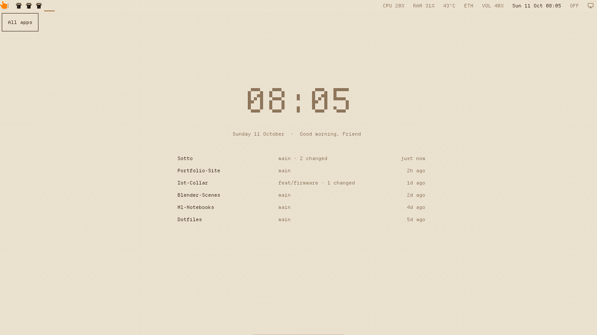

# sotto

*from* sotto voce, *Italian for "in a quiet voice", and* sotto, *"underneath": where a wallpaper lives.*

**A wallpaper that's alive.** It knows what you're working on, it redraws itself from a JSON file, scripts can talk to it, and you can double-click it to ask anything.



The wallpaper is part of a calm, mouse-first [Hyprland](https://hypr.land) desktop. It also has a macOS-style dock and Windows-style window handling, in light colours taken from an old ceiling fresco.

## The wallpaper

It isn't an image or a video. It's **a small program drawing on the desktop itself**: a terminal app running on Hyprland's background layer (`kitty +kitten panel --edge=background`), in a pixel font, one character cell at a time.

- **It shows what matters right now.** A quiet clock, a greeting, and your six most recent projects. Projects are ranked from where you've actually worked:
  - your Claude Code sessions
  - commits *you* authored (cloned repos with someone else's commits don't count)
  - uncommitted edits

  Each row shows its branch, uncommitted changes and when you last touched it. **Click a project to open it.**
- **It's data-driven.** Everything comes from `~/.cache/sotto/state.json`. A collector refreshes it every few minutes, and anything else can write it too. When the file changes, **only the changed cells re-assemble**: they flicker as dots, then settle into the new text. In the GIF, a new project slides into the list that way.
- **Scripts can talk to it.**

  ```sh
  make && python -m sotto say "build finished · 42 tests passed"
  ```

  The message takes the greeting's place for a few seconds. It's useful for long builds, test runs, deploys and reminders.
- **It costs nothing when idle.** If nothing changes, it draws nothing: 0 bytes to the screen and no CPU. It takes about 115 MB of RAM including the terminal it runs in. Moving the mouse over empty space leaves a faint trail of dots that fades out.

## Ask your wallpaper

**Double-click anywhere on the empty wallpaper.** A text line appears right where you clicked. Type and press Enter; the answer types itself out underneath.

Most requests never leave your computer. They're understood locally and happen instantly:

| You type | What happens |
|---|---|
| `open blender` · `launch chrome` · `discord` | opens the app (fuzzy-matched against your installed apps) |
| `open youtube` · `open github.com` | opens the site |
| `play lofi beats on youtube` · `search best laptop under 60000` | searches |
| `open downloads` · `open my-project` | opens the folder, or the project in a terminal |
| `how much ram` · `what time is it` · `cpu temp` · `ip` | answers from the system |
| `lock` · `screenshot` · `volume up` · `mute` | does it |
| `how do I snap windows?` · `how do I minimize?` · `help` | explains this desktop |

**Real questions** ("what is a fresco?", "how does git rebase work?") go to **Claude Haiku** through your Claude Code login and come back in two or three sentences (about 3–6 s):
- It runs as `claude -p` with **no tools, no MCP servers and no saved session**.
- Claude can only *ask* for one of three safe actions (open a URL, open an app, search), which the desktop then carries out. It never runs commands.
- Without Claude Code installed, everything in the table above still works.

It behaves like a popup:
- While you type, it holds the keyboard.
- Esc, a click anywhere else, or switching windows closes it.
- After Enter it gives the keyboard straight back. Click the answer to ask something new.

Try the brain from a terminal: `python -m sotto ask "open youtube"` (add `--do` to actually do it). New commands are a pattern and an action in [`sotto/assistant.py`](sotto/assistant.py).

## The rest of the desktop


- **Dock.** It hides until the mouse touches the bottom edge, then slides up. Pinned apps sit in it, and a dot marks the running ones (no duplicate icons). Right-click an icon for its windows, New Window, Maximize, Keep in Dock / Remove, Quit and Dock Settings, where you choose, order and size the apps.
- **Windows like Windows and macOS.**
  - Title bars with × + – buttons.
  - Click to focus and raise. Real minimize and restore.
  - Maximize that stays a normal window.
  - Alt+Tab.
  - **Drag-to-edge snapping** (halves, quarters, top for maximize), with an outline preview. Drag a snapped window away and it gets its old size back.
- **Top bar.**
  - An Apps button for a Launchpad-style grid.
  - One icon per window: click to switch, click again to minimize, middle-click to close.
  - System status, and a **show desktop** button in the corner (also `Super+D`).

## Install

Tested on Ubuntu 26.04 with Hyprland 0.53, on one 1366×768 screen and a 2016 Intel desktop with 8 GB of RAM.

```sh
git clone https://github.com/ajstars1/sotto ~/Developer/sotto
cd ~/Developer/sotto
sudo apt install $(cat dotfiles/packages.txt)
uv sync --managed-python --python 3.12          # the wallpaper's Python env; immune to OS Python upgrades
./dotfiles/install.sh                           # links configs into ~/.config, backing up what it replaces
```

Set `$sotto` near the top of `dotfiles/hypr/hyprland.conf` to where you cloned the repo. Then log out, pick **Hyprland** on the login screen, and log in. For AI answers, install and log in to [Claude Code](https://claude.com/claude-code).

## Configuration

```toml
# ~/.config/sotto/config.toml
name = "Sam"                          # the greeting
hide = ["~/Developer/some-fork"]      # projects to leave off the wallpaper

[[pin]]                               # always shown, with your own open commands
path = "~/Developer/my-app"
label = "MY-APP"
open = ["kitty --directory {path}", "kitty --directory {path} -e npm run dev"]
```

- **The dock:** Dock Settings (right-click any dock icon), saved to `~/.config/sotto/dock.json`.
- **Palette, keybinds, title bars, bar, launcher, notifications, lock screen:** `dotfiles/`.
- **Shortcuts:** `Super+F1` lists every one.

## How it works

| Part | What it does |
|---|---|
| [`sotto/collect.py`](sotto/collect.py) | builds `state.json`: projects (Claude sessions, your commits, uncommitted edits) and system info. It rewrites the file only when something changed. |
| [`sotto/wall.py`](sotto/wall.py) | the wallpaper: watches `state.json` and the `say` inbox, re-assembles only changed cells, dot trail, clicks, and the double-click that opens the prompt |
| [`sotto/assistant.py`](sotto/assistant.py) | the prompt's brain: local intents first, Claude only for real questions, a whitelist of safe actions |
| [`sotto/dock.py`](sotto/dock.py) | GTK4 + gtk4-layer-shell: the dock, the wallpaper prompt, and the snap preview outline |
| [`dotfiles/hypr/scripts/`](dotfiles/hypr/scripts/) | the desktop behaviour Hyprland doesn't have: snapping (`snap.py` notices a drag by a window moving exactly with the cursor), minimize, maximize, show desktop, top-bar clicks |

`demo/state.json` is the sample data used in the GIFs. Run the wallpaper with `SOTTO_DEMO=1 SOTTO_STATE=demo/state.json` to show it. To render a frame without a screen: `python -m sotto preview out.png`.

## Known limits

- One monitor so far.
- Snapping happens when the drag pauses at an edge, because Hyprland doesn't report the mouse release during title-bar drags.
- Hyprland has no built-in minimize, so minimized windows live on a hidden workspace.

## License

MIT
