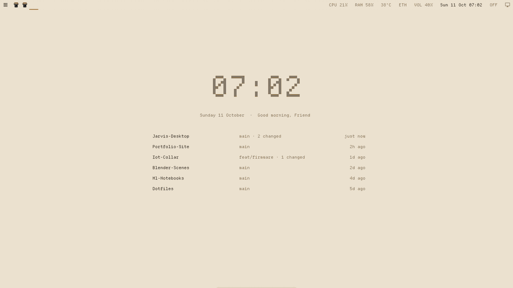

# jarvis-desktop

A calm, mouse-first desktop for [Hyprland](https://hypr.land): a wallpaper you can talk to, a macOS-style dock, and Windows-style window handling, in light colours taken from an old ceiling fresco.



## What you get

- **A living wallpaper.** A quiet clock, a greeting and your recent projects (ranked from your Claude Code sessions, your own commits and uncommitted work). Click a project to open it. Moving the mouse over empty space leaves a faint trail of dots. When nothing changes, nothing is redrawn.
- **An assistant in the wallpaper.** Double-click anywhere on it and type. Small things happen instantly and locally:
  - open apps, sites, folders and projects
  - YouTube and web searches
  - system info: RAM, disk, temperature, IP
  - lock, screenshot, volume
  - how-to questions about this desktop

  Real questions go to Claude Haiku through your Claude Code login (optional). The answer types itself out underneath.
- **A dock.** It hides until the mouse touches the bottom edge, then slides up. Pinned apps sit in it, and a dot marks the running ones (no duplicate icons). Right-click an icon for its windows, New Window, Maximize / Restore, Keep in Dock / Remove, Quit, and Dock Settings, where you choose, order and size the apps.
- **Window handling like Windows and macOS.**
  - Title bars with × + – buttons that act on the window you click.
  - Click to focus and raise. Real minimize and restore.
  - Maximize that keeps windows normal, so others can still come in front.
  - Alt+Tab.
  - Drag-to-edge snapping (halves, quarters, maximize), with an outline preview. Drag a snapped window away and it gets its old size back.
  - Show desktop.
- **A top bar that switches apps.**
  - An Apps button for a Launchpad-style grid.
  - One icon per window: click to switch, click again to minimize, middle-click to close.
  - System status, and a show-desktop button in the corner.

## Requirements

Tested on Ubuntu 26.04 with Hyprland 0.53, on a single 1366×768 screen and a 2016 Intel desktop with 8 GB of RAM. The idle cost is a few tens of MB.

## Install

```sh
git clone https://github.com/ajstars1/jarvis-desktop ~/Developer/jarvis-desktop
cd ~/Developer/jarvis-desktop
sudo apt install $(cat dotfiles/packages.txt)
uv sync --managed-python --python 3.12          # the wallpaper's Python env; immune to OS Python upgrades
./dotfiles/install.sh                           # links configs into ~/.config, backing up what it replaces
```

Set `$jarvis` near the top of `dotfiles/hypr/hyprland.conf` to where you cloned the repo. Then log out, pick **Hyprland** on the login screen, and log in.

Optional: put your name in `~/.config/jarvis/config.toml` (`name = "Sam"`) for the greeting. To use the wallpaper assistant for real questions, install and log in to [Claude Code](https://claude.com/claude-code). Everything else works without it.

## Using it

| | |
|---|---|
| double-click the wallpaper | ask or command; Enter to send, Esc or a click elsewhere to close |
| mouse to the bottom edge | dock |
| drag a title bar to an edge or corner | snap; drag away to restore |
| top bar icons | switch, minimize, close (middle-click) |
| right-click the desktop | Apps, Show desktop, Files, Terminal, Tile / Float windows, Dock settings, Lock, Log out… |
| `Super+Space` | all apps |
| `Super+D` | show desktop |
| `Alt+Tab` | switch windows |
| `Super+F1` | every shortcut |

## Configuration

- `~/.config/jarvis/config.toml`
  - `name`: the greeting
  - `hide`: projects to leave off the wallpaper
  - `[[pin]]`: projects that always show, each with its own `open` commands
- `~/.config/jarvis/dock.json`: the dock's apps, icon size and auto-hide. It's easiest to change through Dock Settings.
- `dotfiles/`: the Hyprland side. Palette, keybinds, title bars, Waybar, rofi, mako and hyprlock.

```toml
# ~/.config/jarvis/config.toml
name = "Sam"
hide = ["~/Developer/some-fork"]

[[pin]]
path = "~/Developer/my-app"
label = "MY-APP"
open = ["kitty --directory {path}", "kitty --directory {path} -e npm run dev"]
```

## How it works

| Part | What it does |
|---|---|
| `jarvis/collect.py` | writes `~/.cache/jarvis/state.json` (projects, system info), only when something changed |
| `jarvis/wall.py` | the wallpaper: a terminal program on Hyprland's background layer (`kitty +kitten panel --edge=background`), drawn cell by cell |
| `jarvis/dock.py` | GTK4 + gtk4-layer-shell: the dock, the snap preview outline and the wallpaper prompt |
| `jarvis/assistant.py` | the prompt's brain: local intents first, Claude only for real questions, a whitelist of safe actions |
| `dotfiles/hypr/scripts/snap.py` | snapping. Hyprland reports no title-bar drags, so it watches for a window that moves exactly with the cursor |
| `dotfiles/hypr/scripts/` | minimize/maximize/show-desktop/taskbar helpers that add the desktop behaviour Hyprland doesn't have |

Preview frames without a screen: `.venv/bin/python -m jarvis preview out.png`. Try the assistant: `.venv/bin/python -m jarvis ask "open youtube"` (add `--do` to really do it). `demo/state.json` holds the sample data used for the GIF; run the wallpaper with `JARVIS_DEMO=1 JARVIS_STATE=demo/state.json` to show it.

## Known limits

- One monitor so far.
- Snapping happens when the drag **pauses** at an edge, because Hyprland doesn't report the mouse release during title-bar drags.
- Hyprland has no built-in minimize, so minimized windows live on a hidden workspace.
- Without `python3-gi-cairo`, the first click after an answer closes the wallpaper prompt instead of passing through.

## License

MIT
